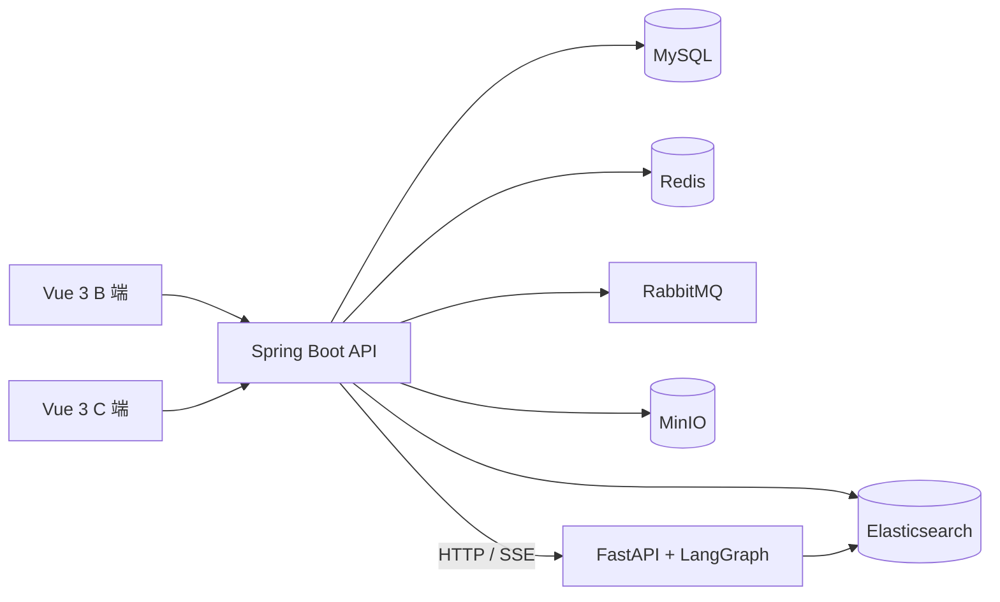

# CBEC · 跨境电商全栈系统

<p align="center">
  <strong>覆盖运营后台、消费者交易闭环与可控 AI 客服的 B2C 工程实践</strong>
</p>

<p align="center">
  
  
  
  
</p>

CBEC 是一个单平台跨境零售系统。Java 后端负责交易、权限和业务数据，两个 Vue 前端分别服务运营人员与消费者，Python 服务负责 AI 编排、知识检索和流式回答。

## 架构



## 已实现能力

| 范围 | 能力 |
| --- | --- |
| B 端运营 | 商品、SKU、订单、会员、优惠券、活动、税费、财务报表、退款与客服工单 |
| C 端交易 | 商品浏览、购物车、一次性结算快照、下单、模拟支付、物流、退款/退货与会员积分 |
| 搜索 | Elasticsearch 商品检索、筛选和排序；搜索故障时回退 MySQL |
| AI 客服 | SSE 对话、BM25/RAG、9 类只读业务工具、来源展示、审计、降级与人工接管 |

## 一致性与安全

- Redis Lua 原子预占多 SKU 库存，MySQL 条件更新兜底；事务回滚补偿 Redis，取消或退款在数据库提交后释放库存。
- 支付单创建使用订单行锁；支付宝回调校验 RSA2 签名、订单和金额，并通过条件更新处理重复通知。
- Spring Security + JWT 区分员工与会员主体，B 端使用方法级 RBAC，C 端校验资源归属。
- 生产配置不默认启用开发 profile 或内置密钥；JWT 密钥少于 32 字节时拒绝启动。
- 图片上传限制大小和 MIME，并校验 JPEG、PNG、WebP、GIF 文件头及 MinIO 对象路径。
- AI 工具只读，Java 侧再次校验白名单、参数与订单归属，模型不直接访问业务数据库。

## 目录

```text
src/main/java/com/mall/   Spring Boot 单模块后端
mall-web/                 Vue 3 + Ant Design Vue 运营后台
mall-storefront/          Vue 3 + Vant 消费者前台
mall-ai-service/          FastAPI + LangGraph AI 服务
src/main/resources/db/    Flyway 迁移与开发数据
docker-compose.yml        本地基础设施与 AI 服务编排
```

## 快速开始

环境要求：Java 23、Maven、Node.js 18+、Docker Desktop。

### 1. 配置环境变量

```powershell
Copy-Item .env.example .env
```

编辑 `.env`，替换所有 `[REDACTED_SECRET]`，并设置至少 32 字节的 `JWT_SECRET`。模型、Embedding、Rerank 与外部可观测平台均为可选配置。

### 2. 启动基础设施

```powershell
docker compose up -d
docker compose ps
```

### 3. 启动后端

```powershell
powershell -ExecutionPolicy Bypass -File scripts/import_dev_seed.ps1 -Reset
mvn spring-boot:run "-Dspring-boot.run.profiles=dev"
```

### 4. 启动前端

```powershell
npm --prefix mall-web install
npm --prefix mall-web run dev
npm --prefix mall-storefront install
npm --prefix mall-storefront run dev
```

## 本地端口

| 服务 | 地址 |
| --- | --- |
| Spring Boot | `http://localhost:18100` |
| AI Service | `http://localhost:18101` |
| C 端前台 | `http://localhost:18102` |
| B 端后台 | `http://localhost:18103` |
| RabbitMQ 管理台 | `http://localhost:18111` |
| Elasticsearch | `http://localhost:19200` |
| MinIO 控制台 | `http://localhost:18121` |

## 验证

```powershell
mvn clean test

npm --prefix mall-web run build
npm --prefix mall-storefront run build

cd mall-ai-service
python -m pytest -q
python evaluate.py
```

2026-09-23 验证基线：Java 156/156、Python 82/82、离线评测 73/73；B/C 两端生产构建与 `docker compose config --quiet` 通过。

## 能力边界

- 当前是单模块 Spring Boot 后端，不是完整微服务架构。
- 支付以开发期模拟流程为主；真实渠道下单、退款、对账和微信回调尚未实现。
- Embedding、Rerank、LangFuse 与外部 OTel 后端需要额外配置，不能视为默认启用。
- Elasticsearch 当前使用单索引重建；生产级集群、别名切换与零停机重建仍是后续工作。
- 通用行级数据权限尚未实现；已分配客服工单的写入使用显式条件 SQL。

---

<p align="center">Build the commerce loop · Keep the AI grounded</p>
